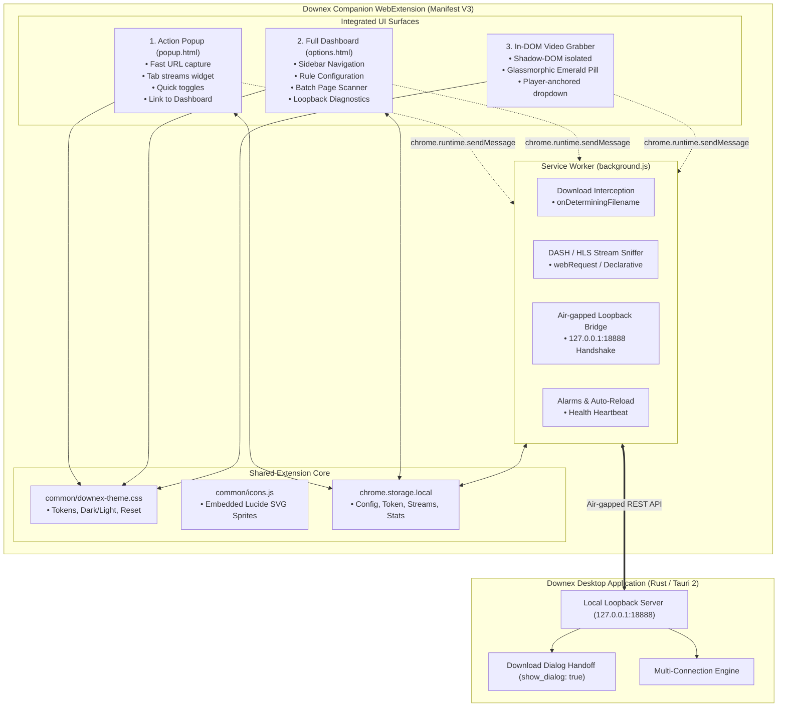

# Downex Browser Extension — Complete UI/UX Redesign & Multi-Page Architecture Plan

**Document Path:** `docs/extension-ui-ux-plan.md`  
**Status:** Architectural Plan & Investigation (Awaiting Explicit User Approval)  
**Target:** Downex Companion WebExtension (Manifest V3)  
**Author:** Antigravity Agent  
**Date:** November 2026  

---

## 1. Executive Summary & Understanding of Requirements

### 1.1 The Core Requirement
The Downex browser extension is the direct companion to the Downex desktop application. It must look, feel, and behave as an organic, seamless part of the Downex desktop ecosystem rather than an ad-hoc, unfinished browser add-on.

### 1.2 Key Objectives
1. **Unified Visual Identity:** Strictly inherit and mirror the Downex desktop design system—utilizing the pure Zinc neutral palette (`#09090b` to `#ffffff`), signature Emerald accents (`#059669` / `#10b981`), cursive `.font-brand` (*Damion*) logo lockup, clean Lucide iconography (`stroke-[2]`), clubbed card containers, and iOS-style emerald toggle switches.
2. **Single Extension, Multiple Integrated Pages:** Transform the extension from a single overloaded 360px popup card into a unified, multi-page extension experience:
   - **Quick-Access Action Popup (`popup/popup.html`):** Fast, lightweight, 380px compact controller for instant downloads, active tab stream detection, and master toggles.
   - **Full-Tab Management Dashboard (`options/options.html`):** Desktop-grade management console mirroring the desktop app's `SettingsView` and sidebar layout for managing filetype filters, deep stream sniffer rules, batch tab downloads, loopback security, and diagnostic logs.
   - **In-DOM Media Grabber Pill (`content.js` Shadow-DOM):** Sleek, dark glassmorphic media grabber floating over HTML5/DASH/HLS players matching desktop modal aesthetics.
3. **Zero Regressions & Absolute Stability:** Preserve 100% of the existing link interception, 3-layer fallback, dynamic modal handoff (`show_dialog: true`), stream detection, loopback authentication token management (`127.0.0.1:18888`), and MV3 service worker event lifecycles.
4. **Lightweight & Dependency-Free:** Zero heavy external frontend frameworks (no bloated runtime in the extension). Utilize modern native Web Components, CSS custom properties, and vanilla ES modules matching the existing clean packaging pipeline in `scripts/ship.mjs`.

---

## 2. Current UI Assessment & Identified Weaknesses

An exhaustive review of the existing extension files (`popup/popup.html`, `popup/popup.js`, `content.js`, `background.js`) reveals several critical visual, layout, and UX shortcomings:

| Area | Current Implementation | Identified Problem & UX Impact |
| :--- | :--- | :--- |
| **Visual Hierarchy & Palette** | Ad-hoc Slate colors (`#64748b`, `#f8fafc`, `#e2e8f0`) with arbitrary green buttons (`#059669`). | Total disconnect from the desktop application's polished Zinc palette (`#09090b`, `zinc-900`, `zinc-100`). Looks like an unstyled demo. |
| **Theming (Dark/Light)** | Hardcoded white background (`--bg: #ffffff`). | No dark mode support whatsoever. Users running Downex desktop in dark mode experience jarring white glare when opening the extension. |
| **Brand Representation** | Generic green rounded box with a capital letter "D" and standard sans-serif text. | Lacks the official Downex brand identity (`icon-arrow.png` + *Damion* cursive wordmark). |
| **Iconography & Micro-copy** | Inconsistent mix of system emojis (`🛡️ 127.0.0.1:18888 • MIT`, `🛠 Run Self-Repair`, `🕒 Later`) and inline SVG icons. | Emojis render inconsistently across Windows versions and look amateurish. The desktop app exclusively uses crisp 1.5px/2px stroke Lucide icons. |
| **Layout Overload** | Single vertical scrolling card containing URL inputs, folder paths, stream toggles, nested checkboxes, link scanners, results lists, and diagnostic consoles. | Clicking anywhere outside closes the popup, destroying unsubmitted batch link scans or active URL entries. Extremely cramped 360px width. |
| **In-Player Media Pill** | Purple/violet theme (`#8b5cf6`, `#a78bfa`) with generic drop-shadow. | Looks like an unrelated third-party script injector rather than official Downex software. |
| **Missing Multi-Page Experience** | No `options_ui` or dedicated settings page declared in `manifest.json`. | Users have no spacious screen to view batch scanned links, manage file filters, or read engine connection logs. |

---

## 3. Desktop Design System Analysis (Design Reference)

The redesign will strictly adhere to the design language established in Downex Desktop (`src/App.css`, `src/components/DownexWindowHeader.tsx`, `src/components/DownexSidebar.tsx`, `src/components/SettingsView.tsx`, `src/components/ui/Button.tsx`, `src/components/NewDownloadModal.tsx`):

### 3.1 Color Tokens & Theming Contract
The extension will declare CSS custom properties mirroring the desktop's `@theme` zinc scale:

```css
:root {
  /* Surface & Backgrounds */
  --dwnx-bg: #ffffff;
  --dwnx-surface: #f4f4f5;         /* zinc-100 */
  --dwnx-card-bg: rgba(250, 250, 250, 0.75); /* zinc-50/75 */
  --dwnx-card-border: rgba(228, 228, 231, 0.8); /* zinc-200/80 */
  --dwnx-divider: rgba(228, 228, 231, 0.6);     /* zinc-200/60 */
  
  /* Text */
  --dwnx-text-main: #18181b;       /* zinc-900 */
  --dwnx-text-muted: #71717a;      /* zinc-500 */
  --dwnx-text-subtle: #a1a1aa;     /* zinc-400 */
  
  /* Brand & Accents */
  --dwnx-emerald: #10b981;         /* emerald-500 */
  --dwnx-emerald-dark: #059669;    /* emerald-600 */
  --dwnx-emerald-hover: #047857;   /* emerald-700 */
  --dwnx-emerald-bg: #ecfdf5;      /* emerald-50 */
  --dwnx-emerald-border: #a7f3d0;  /* emerald-200 */
  --dwnx-emerald-text: #047857;    /* emerald-700 */
}

/* Seamless Dark Mode (Inherited via class or prefers-color-scheme) */
:root.dark, [data-theme="dark"] {
  --dwnx-bg: #09090b;              /* zinc-950 */
  --dwnx-surface: #18181b;          /* zinc-900 */
  --dwnx-card-bg: rgba(24, 24, 27, 0.5); /* zinc-900/50 */
  --dwnx-card-border: rgba(39, 39, 42, 0.6); /* zinc-800/60 */
  --dwnx-divider: rgba(39, 39, 42, 0.6);
  
  --dwnx-text-main: #f4f4f5;       /* zinc-100 */
  --dwnx-text-muted: #a1a1aa;      /* zinc-400 */
  --dwnx-text-subtle: #71717a;     /* zinc-500 */
  
  --dwnx-emerald-bg: rgba(6, 78, 59, 0.35); /* emerald-950/35 */
  --dwnx-emerald-border: rgba(6, 95, 70, 0.6);/* emerald-800/60 */
  --dwnx-emerald-text: #34d399;     /* emerald-400 */
}
```

### 3.2 Typography & Brand Lockup
- **Brand Typography:** The exact cursive font `Damion` used in `DownexWindowHeader.tsx` (`font-brand text-[21px]`). Included locally as an embedded webfont so no external network request is made.
- **Body & Controls:** `Inter, -apple-system, BlinkMacSystemFont, "Segoe UI", Roboto, sans-serif`.
- **Monospace Metrics & Badges:** `ui-monospace, SFMono-Regular, Menlo, monospace` for speeds, ports, versions, and byte sizes.

### 3.3 Component Paradigms
- **Clubbed Cards:** Grouped setting items wrapped in `rounded-xl bg-zinc-50/70 dark:bg-zinc-900/40 border border-zinc-200/80 dark:border-zinc-800/60 divide-y divide-zinc-200/60 dark:divide-zinc-800/60`.
- **iOS-Style Switches:** Smooth 44px × 24px switches with a 20px sliding white thumb, colored `bg-emerald-600` when checked, and `bg-zinc-300 dark:bg-zinc-700` when unchecked.
- **Button System:** Replicating `src/components/ui/Button.tsx`:
  - `primary-emerald`: `bg-emerald-600 hover:bg-emerald-500 text-white rounded-lg font-semibold shadow-xs`
  - `secondary`: `bg-zinc-100 dark:bg-zinc-800 hover:bg-zinc-200 dark:hover:bg-zinc-700 text-zinc-700 dark:text-zinc-200 border border-zinc-200 dark:border-zinc-700`
  - `outline`: `bg-transparent hover:bg-zinc-100 dark:hover:bg-zinc-800/60 border border-zinc-300 dark:border-zinc-700 text-zinc-700 dark:text-zinc-300`
  - `ghost`: Transparent with subtle hover effect.
- **Pills & Status Chips:** `rounded-full text-[11px] font-mono font-medium px-2.5 py-0.5` with pulsing radar dots (`animate-ping`).

---

## 4. Single-Extension, Multi-Page Architecture

Rather than multiple disconnected extensions or trying to squeeze every desktop tool into a transient popup, Downex will implement a **3-tier integrated architecture** within the single extension package:



### 4.1 Page 1: Action Popup (`popup/popup.html` & `popup/popup.js`)
- **Dimensions:** Width fixed at `380px`, dynamic auto-height (min 280px, max 520px).
- **Header:**
  - Downex icon arrow + Damion script wordmark (`downex`).
  - Monospace version badge (`v0.0.3`).
  - Live desktop engine connection pill (`● Connected (v0.0.26)` or `● Disconnected`). Clicking refreshes connection status.
  - Theme toggle button (Sun/Moon).
- **Segmented View Switcher (3 Tabs):**
  1. **Quick Download:** URL input with auto-paste, instant live file size probing badge, destination path preview, and primary "Start Download" / "Later" buttons.
  2. **Active Streams:** Displays any audio/video media discovered on the active tab (resolution, format, audio bitrate) with a 1-click download button.
  3. **Preferences:** Fast toggles for Auto-Capture Downloads, Video Grabber, and Alt-Key Quick Bypass.
- **Footer:**
  - Loopback status (`127.0.0.1:18888`).
  - Prominent button: **"Open Dashboard ↗"** which executes `chrome.runtime.openOptionsPage()`.

### 4.2 Page 2: Dedicated Full-Tab Dashboard (`options/options.html` & `options/options.js`)
- **Access:** Registered as `"options_ui": { "page": "options/options.html", "open_in_tab": true }`. Accessible via right-click extension icon → "Options", from the popup's "Open Dashboard" button, or via `chrome://extensions`.
- **Layout:** Replicates Downex Desktop's shell (`DownexSidebar` + main content area):
  - **Left Sidebar:**
    - Logo header lockup.
    - Navigation Items:
      - `Overview & Bridge`: Engine connection, handshake status, roundtrip ping latency, app vs extension version.
      - `Filetype Rules`: Editable list of intercepted extensions (`.zip`, `.exe`, `.iso`, `.tar`, `.mkv`), custom exclusion domains, and minimum file size slider.
      - `Media & Video Sniffer`: YouTube / DASH / HLS capture sensitivity, in-player overlay visibility, quality badge preferences.
      - `Batch Page Scanner`: Full-screen interface to scan the active browser tab for all downloadable links, images, documents, and media streams, with filter chips, batch select checkboxes, and direct queue handoff.
      - `Diagnostics & Logs`: Real-time loopback connection logs, token status, manual self-repair trigger, and extension hot-reload trigger.
  - **Main Content Pane:**
    - Clean clubbed card interface matching `SettingsView.tsx`.
    - Live toast feedback when settings are saved to `chrome.storage.local`.

### 4.3 Page 3: In-DOM Media Grabber Pill (`content.js` Shadow-DOM)
- **Aesthetic Overhaul:**
  - Modern dark glassmorphic styling: `rgba(9, 9, 11, 0.88)` with `backdrop-filter: blur(16px)` and subtle `rgba(255, 255, 255, 0.12)` border.
  - Emerald status indicator and Downex arrow icon.
  - Stream dropdown menu featuring desktop-grade typography, resolution badges (`1080p 60fps`, `4K HDR`, `Audio Only`), and direct click handoff.

---

## 5. File Structure & Module Organization

To ensure zero false positives, complete clean-packaging compatibility with `scripts/ship.mjs`, and maintainable architecture:

```
downex-browser-extension/
├── manifest.json              # Updated with options_ui declaration and clean resource permissions
├── background.js              # Service worker (Preserved: download interception, bridge, tokens)
├── content.js                 # Content script (Updated Shadow-DOM styling & themes)
├── page-hook.js               # Injected page hook (Preserved: DASH/HLS stream detection)
├── common/                    # Shared design tokens & assets across all extension pages
│   ├── downex-theme.css       # Unified CSS custom properties, button styles, card styles, switches
│   ├── icons.js               # Lucide SVG icon helper generating crisp vector icons
│   └── damion.woff2           # Embedded local cursive font for "downex" wordmark
├── popup/
│   ├── popup.html             # Re-architected 380px multi-tab action popup
│   ├── popup.css              # Clean layout styling referencing downex-theme.css
│   └── popup.js               # Controller for popup tabs, probing, and quick downloads
├── options/                   # NEW: Full-Tab Extension Management Dashboard
│   ├── options.html           # Desktop-grade dashboard HTML with sidebar navigation
│   ├── options.css            # Dashboard layout matching Downex desktop
│   └── options.js             # Controller for rules, batch link scanner, logs, and repair
└── icons/                     # Extension branding icons
    ├── icon16.png
    ├── icon32.png
    ├── icon48.png
    └── icon128.png
```

---

## 6. Compatibility & Security Preservation

The implementation strictly maintains all existing security and functional contracts:

1. **Download Interception Hygiene:**
   - The authoritative `chrome.downloads.onDeterminingFilename` hook in `background.js` remains completely untouched.
   - The 3-layer fallback system (`dynamic modal dispatch` → `desktop UI trigger` → `browser native fallback`) continues to operate without modification.
2. **Loopback Bridge & Security:**
   - Communication remains strictly restricted to air-gapped `http://127.0.0.1:18888`.
   - Token authentication via `Authorization: Bearer <token>` and `X-Downex-Token` is preserved.
   - Fast retry and self-healing token refresh logic is untouched.
3. **Packaging & Release Pipeline:**
   - `scripts/ship.mjs` inspects `downex-browser-extension/` and copies all `.js`, `.json`, `.html`, `.css`, `.png`, `.svg`, and `.woff2` files into `dist-extension/`.
   - By avoiding external npm bundlers (Webpack/Vite) inside the extension directory, the build remains instantaneous, zero-dependency, and generates no prohibited `.bat` or binary artifacts.
4. **State Synchronization:**
   - Both the popup and options dashboard read from and write to `chrome.storage.local`.
   - `chrome.storage.onChanged` automatically syncs configuration across all open extension tabs and content scripts immediately.

---

## 7. Step-by-Step Implementation Roadmap (Upon Approval)

Once approved by the user, execution will proceed through the following controlled stages:

### Stage 1: Shared Design Tokens & Assets
- Create `downex-browser-extension/common/downex-theme.css` with the full Zinc + Emerald variable palette, light/dark themes, switch components, and button utility classes.
- Create `downex-browser-extension/common/icons.js` containing inline SVG definitions for Lucide icons (`Download`, `Settings`, `Activity`, `Check`, `RefreshCw`, `Sliders`, `Shield`, `Layers`, `ExternalLink`, `Moon`, `Sun`).

### Stage 2: Manifest V3 Registration
- Update `downex-browser-extension/manifest.json`:
  - Register `"options_ui": { "page": "options/options.html", "open_in_tab": true }`.
  - Expose `common/*` in `web_accessible_resources`.

### Stage 3: Redesign Action Popup (`popup/`)
- Rebuild `popup/popup.html`:
  - Authentic Downex brand header with Damion cursive wordmark and connection badge.
  - Tab navigation: `[Quick Add]` | `[Streams]` | `[Preferences]`.
  - Polished quick download card with live file size probing and folder path preview.
  - Footer with loopback indicator and "Open Dashboard ↗" button.
- Refactor `popup/popup.js` to manage tab switching and sync with `chrome.storage.local`.

### Stage 4: Author Full Management Dashboard (`options/`)
- Implement `options/options.html`, `options/options.css`, and `options/options.js`:
  - Sidebar navigation replicating `DownexSidebar.tsx`.
  - Section 1: Overview & Bridge status with ping diagnostics.
  - Section 2: Interception rules & filetype tag editor.
  - Section 3: Media & stream sniffer controls.
  - Section 4: Full-page batch tab link scanner.
  - Section 5: Real-time connection log & self-repair runner.

### Stage 5: In-DOM Shadow-DOM Media Pill Polish (`content.js`)
- Update the Shadow-DOM stylesheet inside `content.js` to replace purple styling with Downex dark glassmorphism, crisp emerald accents, and standard Lucide SVG icons.

### Stage 6: Targeted Verification & Hygiene Check
- Test connection ping and token exchange with the live running `Downex.exe` engine.
- Verify download grabbing on direct links and CDN links (e.g. HubCDN).
- Verify dark/light mode toggle persistence.
- Execute Windows Defender heuristic scan (`MpCmdRun.exe`) to ensure zero false positives.

---

## 8. Verification & Safeguards Protocol

To adhere to Rule 10 (Token Conservation & Smart Targeted Verification) and Rule 9 (Antivirus Heuristic Safety):

1. **Visual & Theme Verification:**
   - Open popup in both light mode and dark mode; verify contrast, font rendering, and layout alignment.
   - Open options page in browser tab; verify sidebar collapse, tab transitions, and card responsiveness.
2. **Functional Download Verification:**
   - Trigger a download from the quick-add input; verify that `Downex.exe` catches it and opens the dynamic modal.
   - Click a download link in browser; verify that automatic interception captures the file with no double-triggering.
3. **Cross-Page State Synchronization:**
   - Toggle "Auto-Capture Downloads" in the options page; verify that the popup immediately updates its toggle switch via `chrome.storage.onChanged`.
4. **Defender Heuristic Scan:**
   - Run Microsoft Defender `MpCmdRun.exe -Scan -ScanType 3 -File c:\GITHUB\downex\downex-browser-extension` to verify 100% clean status.

---

## 9. Gate: Review & Explicit Approval

> [!IMPORTANT]
> **GATE NOTICE:** In accordance with user instructions, all work remains in the planning phase. No code, styles, or configuration files in `downex-browser-extension/` or `src/` have been altered. 
> 
> Awaiting user review and explicit command before proceeding to implementation.

