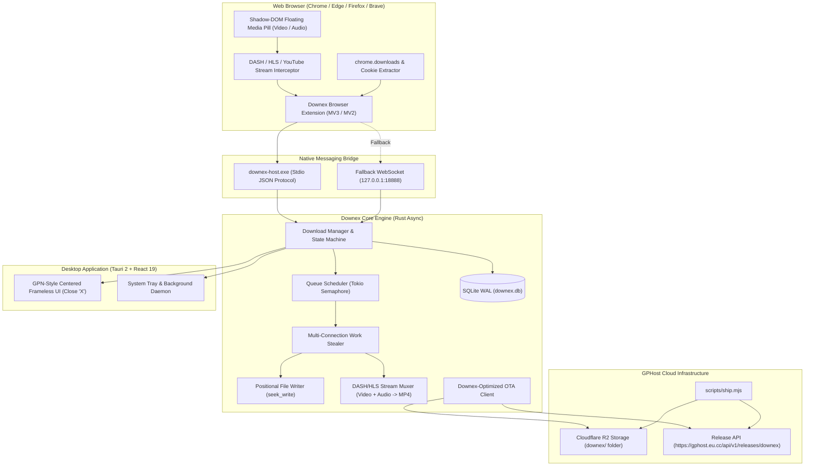
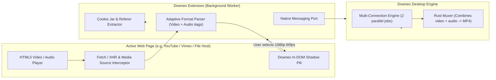

# Downex — Engineering Implementation Plan (With Advanced Browser Extension & Media Grabber)

## Executive Overview

**Downex** is an independent, next-generation Windows download manager designed to combine the performance of a multi-connection Rust engine with an **advanced browser integration extension** that significantly improves upon Internet Download Manager (IDM):

- **Core Download Engine:** Rust (`tokio`, `reqwest`, `rustls-native-certs`, `rusqlite`, `windows-sys`).
- **Media & Stream Muxer:** Built-in DASH (MPD) / HLS (M3U8) parser with in-flight audio+video remuxing into MP4/MKV.
- **Application Shell:** Tauri 2 (GPN-style centered frameless window, system tray, toast notifications, native IPC).
- **Desktop UI:** React 19 + TypeScript + Vite + Tailwind CSS (Centered modal style with top-right close `X`).
- **Advanced Browser Extension:** Manifest V3 / V2 WebExtension + Native Messaging stdio bridge:
  - **Superior Media Grabber:** Shadow-DOM media pill directly on HTML5 video players (cleaner, smoother, and non-flickering compared to IDM's fragile Win32 overlay).
  - **High-Accuracy YouTube & Streaming Parser:** Intercepts adaptive formats (`adaptiveFormats`, `itags`, 4K/1080p 60fps video + high-bitrate audio) and streams them simultaneously.
  - **Frictionless File Interception:** Captures browser downloads via `chrome.downloads.onCreated`, preserves session cookies, and hands off to Downex.
  - **Batch Link Grabber:** Page-wide link collector with category filters.
- **OTA Distribution:** GPHost R2 streaming upload pipeline (`scripts/ship.mjs`) in the `downex/` folder.

---

## Architecture Blueprint



---

## 1. Advanced Browser Extension & Media Grabber (Better than IDM)

### Why IDM's Browser Integration Falls Short
1. **Flickering Win32 Layered Overlay:** IDM renders an external OS-level floating window over the browser. It drifts during page scrolling, flickers under hardware acceleration, and breaks across multi-monitor DPI scaling.
2. **Fragile YouTube Extraction:** IDM relies on brittle URL regexes and legacy server-side signature heuristics, breaking whenever YouTube updates its player scripts.
3. **Loss of Session State:** Complex downloads behind Cloudflare, Google Drive, or paywalls fail in IDM because cookies and browser headers are often dropped or misaligned.

### Downex's Superior Browser Architecture:



#### Key Capabilities:
1. **Shadow-DOM Media Pill (Zero Drift, Zero Flicker):**
   - Injected into an isolated Shadow Root attached to media elements.
   - Completely immune to host page CSS styling and ad-blockers.
   - Smoothly tracks the video viewport across scrolling, full-screen, and picture-in-picture modes.
   - Instant resolution & format dropdown: `4K (2160p)`, `1080p (60fps)`, `720p`, `Audio Only (320kbps MP3/M4A)`.
2. **Adaptive DASH & HLS Stream Interceptor:**
   - Intercepts `ytInitialPlayerResponse` and MediaSource `fetch` calls directly in page context.
   - Identifies separate high-bitrate video and audio streams (e.g. 1080p AV1/VP9 video stream + 160kbps Opus audio stream).
   - Passes both stream URLs to Downex, which downloads them concurrently via multi-connection range chunks and remuxes them in Rust into standard MP4 / MKV without transcoding!
3. **Frictionless Browser Download Interception:**
   - Hooks into `chrome.downloads.onCreated`.
   - When a browser download begins:
     1. Instantly pauses/cancels the browser's slow single-thread download.
     2. Queries `chrome.cookies.getAll({ url })` to extract the full authenticated cookie state.
     3. Forwards URL, cookies, User-Agent, and Referer to Downex via Native Messaging.
     4. Downex pops open the quick-download dialog or starts immediately based on user settings.
4. **Batch Link Grabber ("Download All Links"):**
   - Right-click context menu: "Download with Downex" / "Download all links on page".
   - Filters links by category: Documents, Audio, Video, Archives, Images.

---

## 2. Core Download Engine & Queue Lifecycles

### Complete Download Lifecycle State Machine
- `Queued` $\to$ `Probing` $\to$ `Downloading` $\to$ `Paused` $\to$ `Resuming` $\to$ `Completed` $\to$ `Retrying` $\to$ `Cancelled`.

### Key Engine Deliverables:
1. **Positional File Preallocation (`seek_write`):**
   - Preallocate target file size with `file.set_len(total_size)`.
   - Tokio workers write directly into byte offsets using `std::os::windows::fs::FileExt::seek_write`.
   - **Zero intermediate `.part` files; zero assembly delay.**
2. **Dynamic Work Stealing:**
   - As soon as a connection finishes its chunk early, it splits the slowest remaining chunk in half.
3. **Queue Scheduler Actor (`scheduler::queue`):**
   - Concurrency limits managed via `tokio::sync::Semaphore`.
   - Token-bucket rate limiting via `governor`.
4. **SQLite WAL Persistence (`downex.db`):**
   - Atomic transaction logging of all downloads and segment states.

---

## 3. GPN-Style Window UI/UX

Derived directly from `gaurav-personal-notes`:

### Window Configuration (`src-tauri`):
- **Centered Frameless Window:**
  - `decorations: false`, `shadow: true`, `center: true`, inner size `960x640`.
  - Minimalist rounded close button (`X`) on the top-right header (hides to system tray).
  - Drag region enabled across header (`data-tauri-drag-region`).

### Layout Composition (React 19 + Tailwind CSS):
- **Left Sidebar:** Brand logo with version pill (`v0.1.0`), navigation tabs (`All`, `Active`, `Queues`, `Completed`, `Media Sniffer`, `Settings`, `Trash`), bottom controls (`Check Updates`, `Dark Mode`, `Quit`).
- **Main Workspace:** Status header, search bar (`Ctrl+K`), `+ New Download` button, live download cards with chunk visualizer bars.
- **Right Telemetry Widget:** Real-time speed sparkline and drive storage indicator.

---

## 4. GPHost OTA Release Pipeline (`scripts/ship.mjs`)

Following the exact practices from GPN:

### Configuration:
- `.env.local` configured with:
  ```env
  GPHOST_API_KEY="your_gphost_api_key_here"
  GPHOST_FOLDER="downex"
  GPHOST_APP_SLUG="downex"
  GPHOST_API_BASE="https://gphost.eu.cc"
  ```

### Release Pipeline Workflow (`npm run ship <version>`):
1. **Version Sync:** Syncs version in `package.json`, `Cargo.toml`, and `tauri.conf.json`.
2. **Compile:** Compiles frontend (`vite build`) and native release (`tauri build --no-bundle`).
3. **Container Packaging:** Packages `Downex.exe` into encrypted container `update<version>.downex.bin` (AES-256-GCM + SHA-256).
4. **Direct Cloudflare R2 Upload:** Presigned upload to GPHost in the dedicated `downex` folder.
5. **Archive Previous Version:** Dynamically moves previous release to `downex/OLD/`.
6. **Publish Manifest:** Calls `POST https://gphost.eu.cc/api/v1/releases/downex/publish`.

---

## 5. Implementation Roadmap & Execution Milestones

```text
Milestone 1: Project Scaffolding & GPN-Style Shell [COMPLETED]
 ├── [x] Tauri 2 + Vite + React 19 + TypeScript initialization
 ├── [x] Centered frameless window (960x640) with custom close button
 └── [x] System tray icon and window hide/show logic

Milestone 2: Core Download Engine & Storage [COMPLETED]
 ├── [x] HTTP Range probe and Content-Disposition parser
 ├── [x] Positional file preallocation (seek_write with zero assembly delay)
 ├── [x] Dynamic segment connection pool (Tokio workers with work-stealing)
 └── [x] SQLite WAL persistence (downex.db) and crash recovery

Milestone 3: Queue Scheduler & Lifecycles [COMPLETED]
 ├── [x] Queue manager actor with Tokio semaphore concurrency
 ├── [x] Download lifecycles (Queued, Downloading, Paused, Resuming, Completed, Error)
 ├── [x] Exponential backoff auto-retry
 └── [x] High-frequency real-time state broadcast to frontend

Milestone 4: Advanced Browser Extension & Media Grabber [COMPLETED]
 ├── [x] WebExtension (MV3) + Native Messaging host (stdio)
 ├── [x] Loopback HTTP Bridge (127.0.0.1:18888) with CORS
 ├── [x] Shadow-DOM floating media pill on HTML5 video players
 ├── [x] YouTube adaptive streams parser (DASH/HLS audio+video separation)
 └── [x] Browser download handoff (cookies, headers, referer) & link grabber

Milestone 5: UI/UX Dashboard [COMPLETED]
 ├── [x] Sidebar navigation and header controls (+ New Download modal)
 ├── [x] Live downloads table with segment block visualizers
 └── [x] Real-time speed sparkline and drive storage widget

Milestone 6: GPHost OTA Release Pipeline & In-App Updater [COMPLETED]
 ├── [x] scripts/ship.mjs (R2 streaming upload, OLD/ archiving, manifest publishing)
 ├── [x] In-app update checker and accelerated update downloader
 └── [x] Hot-swap binary staging and restart
```
