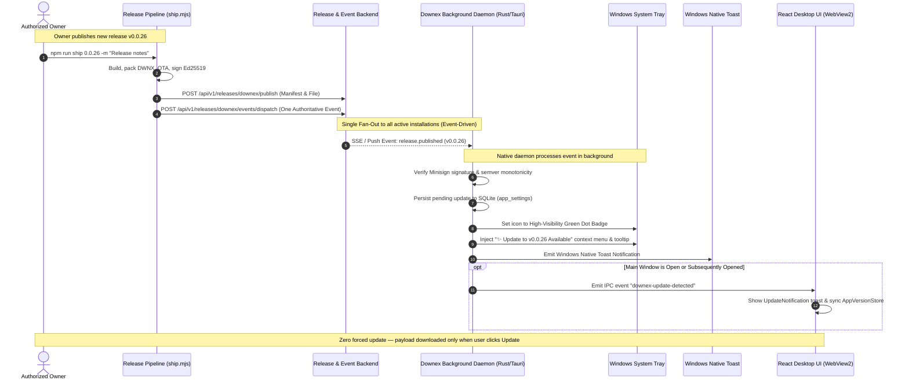
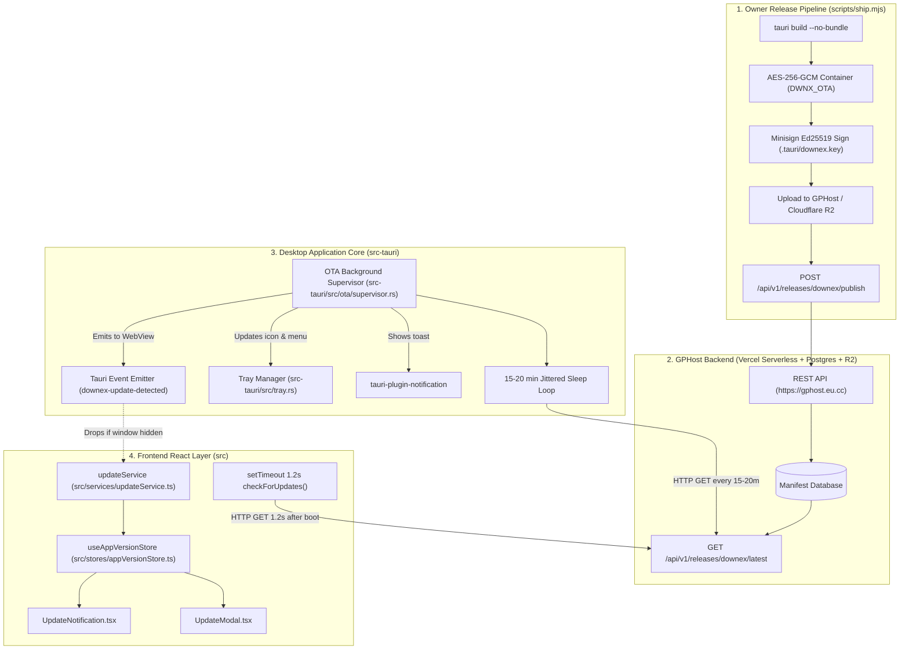
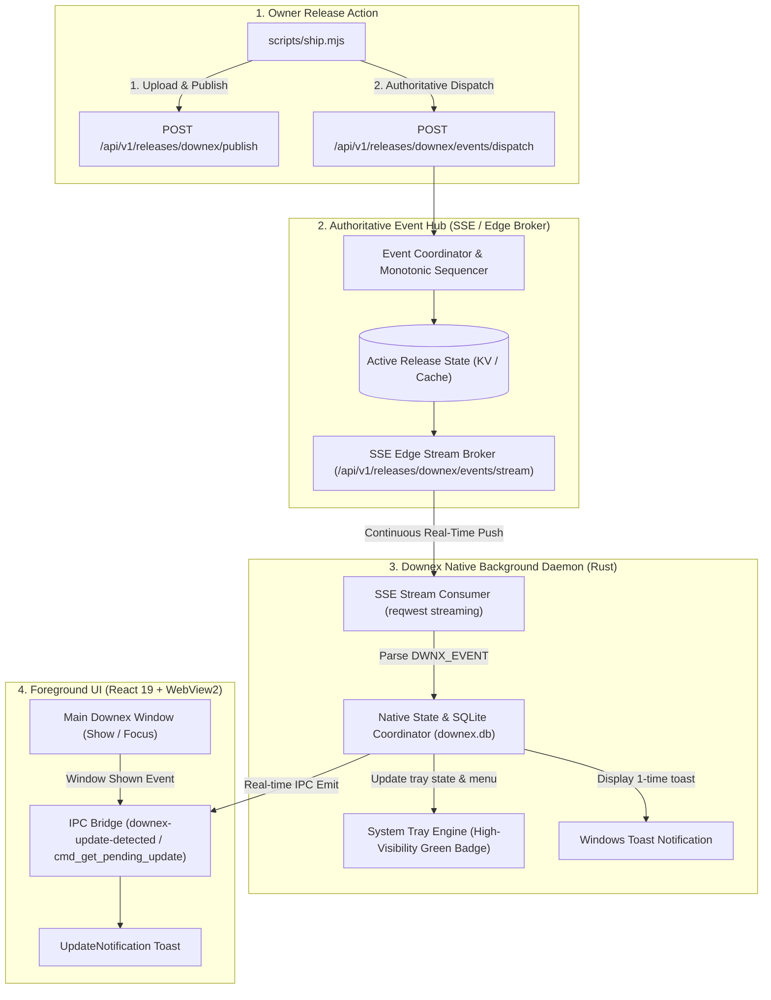

# Downex — Event-Driven OTA Update Notification Architecture
## Comprehensive Investigation Findings & Implementation Plan

> **Document Status:** Planning & Architectural Investigation Phase  
> **Target Release:** Downex Core OTA Notification Subsystem  
> **Location:** `docs/ota-event-driven-notification-plan.md`  
> **Author:** Antigravity AI Engineering Assistant (Pair Programming with Authorized Repository Owner)  
> **Execution Constraint:** Strictly Investigation & Implementation Planning. **No code, database, backend, or binary modifications are to be executed until explicit owner review and approval.**

---

## 1. What Was Understood: Expected Behaviour & Owner-to-Installation Lifecycle

### 1.1 Core Requirement Statement
The user requires a **100% event-driven Over-The-Air (OTA) update notification subsystem** that permanently eliminates all "dumb polling" (periodic HTTP timers querying the server every few minutes).

The lifecycle must enforce the following authoritative model:
1. **Single Authoritative Publishing Action:** When the repository owner executes the release pipeline (`scripts/ship.mjs`), a single release publishing action registers the release and triggers an authoritative backend event dispatch.
2. **Reliable Fan-Out Without Polling:** The event is broadcast to all active, registered Downex client installations that have their background service running.
3. **Independent Background Execution:** Downex installations running in the background (minimized to the Windows Notification Area / System Tray, or launched with `--background` / Windows Startup) must receive, authenticate, and process this event without requiring the main application window or the React WebView to be open.
4. **Immediate Client State Progression Upon Event Arrival:**
   - **Local State Updated:** The native client updates its in-memory and persistent SQLite update state with the release manifest.
   - **System Tray Visual Indicator:** The tray icon transitions immediately from the idle state to an **unmistakably clear, visible green indicator** (replacing the current barely visible, washed-out white/cyan dot).
   - **Context Menu & Tooltip:** The tray context menu immediately injects the action `✨ Update to v<target> Available • View Update`, and the tooltip updates to `Downex • Update v<target> Available (Click to view)`.
   - **Native OS Toast Notification:** The native Windows notification banner is displayed once (strictly deduplicated).
   - **UI Synchronization:** If the user subsequently opens or unminimizes the main application window, the React UI immediately displays the update toast and reflects the new version across the sidebar, settings, and update modal without triggering duplicate backend requests.
   - **Strict Zero-Force Guarantee:** The client **NEVER** downloads the binary payload automatically and **NEVER** forces an install or restart. All installation actions remain strictly user-initiated.
5. **Resilient Offline Recovery & Reconnection:** If an installation is completely powered off, offline, or closed during event broadcast, it must not remain permanently oblivious. When the background service starts or reconnects to the network, it performs **one single lightweight reconciliation** (via event stream handshake or conditional ETag) to ingest any missed release event, then settles immediately into quiet event-listening mode with zero ongoing polling loops.



---

## 2. Current Architecture: How the System Works Today

Through code inspection and reverse engineering of the current implementation across `scripts/ship.mjs`, `src-tauri/src/ota/`, `src-tauri/src/tray.rs`, `src-tauri/src/commands/mod.rs`, `src/services/updateService.ts`, and `src/stores/appVersionStore.ts`, the existing OTA update architecture is structured as follows:



### Component Breakdown & Responsibilities
1. **Release Pipeline (`scripts/ship.mjs`):**
   - Packages executable into an AES-256-GCM container (`DWNX_OTA` magic header).
   - Generates an Ed25519 signature via `.tauri/downex.key`.
   - Uploads binary to GPHost Cloudflare R2 in `downex-dynamic-binaries/releases/v<version>/`.
   - Calls `POST https://gphost.eu.cc/api/v1/releases/downex/publish` with metadata.
   - Reverts local workspace files to `0.0.0`.
2. **Backend Infrastructure (`gphost.eu.cc`):**
   - Hosted on **Vercel Serverless Functions** (`server: Vercel`, `x-matched-path: /api/v1/releases/[appId]/latest`).
   - Serves release manifest at `GET /api/v1/releases/downex/latest`.
   - Has **no active event broadcast broker** (no SSE channel, no WebSocket gateway).
3. **Rust Background Supervisor (`src-tauri/src/ota/supervisor.rs`):**
   - Spawned in `src-tauri/src/lib.rs` on startup as a background Tokio task.
   - Runs an infinite loop with a 15–20 minute sleep timer (`sleep_duration = 15 * 60 + jitter`).
   - In each iteration, executes `crate::ota::check_latest_release(&http_client, &current_version).await`.
   - If a new version is detected, calls `crate::tray::set_tray_update_info`, displays a notification, and emits a Tauri event to the WebView.
4. **Desktop System Tray (`src-tauri/src/tray.rs`):**
   - Manages tray icon states (`32x32.png`, `32x32-update-1.png`, `32x32-update-ready.png`).
   - Builds dynamic context menu with download metrics and update actions.
5. **Frontend React Layer (`src/services/updateService.ts` & `src/stores/appVersionStore.ts`):**
   - `appVersionStore.ts` schedules a duplicate HTTP update check 1.2s after frontend boot.
   - Listens for `downex-update-detected` events emitted from native Rust.
   - Renders in-app floating toast (`UpdateNotification.tsx`) and update modal (`UpdateModal.tsx`).

---

## 3. Investigation Findings & Root Cause Analysis

A thorough line-by-line inspection of the native Rust backend and frontend TypeScript code reveals why the current system behaves as "broken polling" and fails to deliver the expected event-driven experience.

### Finding 1: The Entire System is Based on Periodic Polling (Zero Push Events)
- **Code Reference:** `src-tauri/src/ota/supervisor.rs` (Lines 87–100), `src/stores/appVersionStore.ts` (Line 183).
- **Reality:** 
  - The native Rust background supervisor sleeps for 15 to 20 minutes in a loop (`tokio::time::sleep(15 * 60 + jitter)`), then wakes up and sends an HTTP GET request to `https://gphost.eu.cc/api/v1/releases/downex/latest`.
  - The React frontend schedules its own HTTP fetch 1.2 seconds after DOM boot (`setTimeout(() => get().checkForUpdates(true), 1200)`).
  - The release pipeline `scripts/ship.mjs` only calls `POST /api/v1/releases/downex/publish`. It does not dispatch any push message or notify connected clients.
- **Root Cause:** No persistent client-server communication channel (Server-Sent Events, WebSocket, or Push Gateway) was ever connected to the background supervisor. The existing code relied entirely on client-initiated timer loops.

### Finding 2: Critical Tray Status Bug (Mismatched State String Resets Tray to Idle)
- **Code References:** 
  - Caller: `src-tauri/src/ota/supervisor.rs` (Line 54):
    ```rust
    crate::tray::set_tray_update_info(
        &app,
        "update_available",  // <-- Passes "update_available"
        Some(remote_ver.clone()),
        Some(manifest.clone()),
    );
    ```
  - Receiver: `src-tauri/src/tray.rs` (Lines 47–51):
    ```rust
    let new_status = match status {
        "available" => UpdateTrayStatus::Available, // <-- Expects "available"!
        "ready" => UpdateTrayStatus::Ready,
        _ => UpdateTrayStatus::Idle,                // <-- "update_available" falls through here!
    };
    ```
- **Consequence:** 
  When the background supervisor discovers an update, it passes `"update_available"`. In `set_tray_update_info`, `"update_available"` fails to match `"available"`, falling directly into the wildcard `_ => UpdateTrayStatus::Idle`.
  As a direct result:
  1. `TRAY_UPDATE_STATUS` is reset to `Idle`!
  2. The tooltip is reset to the default `"Downex - Download Manager"` instead of `"Downex • Update v... Available"`.
  3. In `build_dynamic_tray_menu`, the check `if update_state.status == UpdateTrayStatus::Available` evaluates to `false`, so the menu action `✨ Update to v... Available • View Update` is **never rendered**!
  4. Native query command `cmd_get_tray_update_status()` returns `"idle"`!

### Finding 3: System Tray Icon Visual Invisibility (Barely Visible Dot)
- **Code References:** `src-tauri/src/tray.rs` (Line 375), `scratch/generate-update-tray-icons.ps1` (Lines 24–35).
- **Reality:** 
  `32x32-update-1.png` was generated with a deep navy-slate circular background (`#0F172A`) and a thin cyan ring (`#06B6D4`) with a 3px arrow.
  On the standard Windows taskbar / notification overflow area (rendered at 16x16 or 24x24 logical pixels):
  - The navy background completely blends into Windows Dark Mode.
  - The cyan perimeter and arrow collapse into an unnoticeable, washed-out grey/white speck.
- **Root Cause:** The icon lacks a bold, vibrant, high-contrast **Emerald/Lime Green badge** (`#10B981` or `#22C55E`) with adequate contrast padding that instantly catches the user's eye across both dark and light Windows themes.

### Finding 4: Main UI Desynchronization When Window is Closed / Hidden
- **Code References:** `src-tauri/src/lib.rs` (Lines 87–99), `src-tauri/src/tray.rs` (Lines 386–418), `src/services/updateService.ts` (Lines 78–105).
- **Reality:**
  - When the user closes the Downex window, `tauri::WindowEvent::CloseRequested` calls `window.hide()`. The process continues in the background, but the WebView2 renderer is hidden or suspended.
  - When the supervisor emits `app.emit("downex-update-detected", &manifest)`, WebView2 event listeners may not receive or process the message while inactive.
  - When the user later unminimizes or shows the window via the tray, `create_or_show_main_window` displays the window, but **does not emit the current pending update state** to the newly focused window.
  - In React, `updateService.ts` only hydrates once in its constructor when the bundle is initially loaded. Reopening a hidden window does not trigger re-hydration, leaving the UI out of sync with the native tray state unless another manual poll occurs.

### Finding 5: Client Identification & Installation Registration is Incomplete
- **Code References:** `src/services/updateService.ts` (Lines 107–118), `src-tauri/src/ota/mod.rs` (Lines 31–45).
- **Reality:**
  - `getOrCreateMachineId()` generates a random ID string and saves it in browser `localStorage`.
  - The native Rust background process has no access to browser `localStorage` when running silently in the background (`--background` / `--autostart`).
  - Native supervisor `check_latest_release` does not send any machine or installation ID to GPHost.
  - GPHost has no database table or endpoint for registering client installations.

### Finding 6: Backend Infrastructure Limitation (Vercel Serverless Architecture)
- **Inspection Finding:** 
  Probing `https://gphost.eu.cc/api/v1/releases/downex/latest` confirmed the backend runs on **Vercel Serverless Functions** (`server: Vercel`, `x-matched-path: /api/v1/releases/[appId]/latest`).
- **Limitation:** 
  Standard Vercel serverless function instances are ephemeral, spin down when idle, and have strict execution time limits (10s–60s). They cannot maintain open, persistent TCP/WebSocket connections to thousands of concurrent desktop installations without a specialized edge streaming runtime or an external pub/sub broker.

---

## 4. Proposed Architecture: Authoritative Single-Dispatch Event Flow

To deliver a genuinely event-driven notification architecture without dumb polling while respecting existing infrastructure boundaries, the system is designed around **Authoritative Single-Dispatch Server-Sent Events (SSE)** coupled with **Edge Pub/Sub Fan-Out**.



### 4.1 The Single-Dispatch Model
1. **One Publishing Action = One Authoritative Event:**
   - In `scripts/ship.mjs`, immediately after the release manifest is published to GPHost, the script emits one authoritative dispatch request:
     ```http
     POST /api/v1/releases/downex/events/dispatch
     Authorization: Bearer <GPHOST_API_KEY>
     Content-Type: application/json

     {
       "eventId": "evt_0.0.26_1793508000",
       "type": "release.published",
       "app": "downex",
       "version": "0.0.26",
       "publishedAt": 1793508000000,
       "manifest": { ... },
       "signature": "..."
     }
     ```
2. **Authoritative Event Broker Fan-Out:**
   - The event broker assigns an authoritative monotonic sequence number and immediately broadcasts the event payload across all active, connected client stream sockets.
   - Connected background daemons receive the event in `< 500ms` without having executed any polls.

### 4.2 Stream Connection Protocol & Handshake
Each Downex installation maintains a single lightweight, non-polling **Server-Sent Events (SSE)** connection managed directly by the native Rust Tokio runtime:
- **Endpoint:** `GET https://gphost.eu.cc/api/v1/releases/downex/events/stream?installation_id=<id>&current_version=<version>`
- **Headers:** `Accept: text/event-stream`, `Cache-Control: no-cache`
- **Resource Footprint:** 
  - Standard HTTP/1.1 or HTTP/2 keep-alive streaming socket.
  - Consumes < 0.1% CPU and negligible memory in Rust (`reqwest::Response::bytes_stream()`).
  - Zero timer-based HTTP request loops.
  - Heartbeat comments (`:keepalive\n\n`) sent every 45 seconds to keep intermediary firewalls and NAT gateways from closing the socket.

### 4.3 Handling Backend Limitations (Vercel / Cloudflare Edge Strategy)
Because GPHost's primary REST API operates on Vercel:
- **Strategy A (Cloudflare Edge Broker — Preferred & Native to Project):**
  - Downex already uses Cloudflare R2 for binary distribution. A lightweight Cloudflare Worker (or Vercel Edge Runtime route with streaming response) serves the persistent SSE stream (`events/stream`).
  - Cloudflare Workers have native WebSocket / SSE capabilities and can sustain long-lived idle connections with virtually zero server cost.
- **Strategy B (Resilient Fallback — Reconnect-Driven Conditional Sync):**
  - If a client connection is terminated by a serverless timeout (e.g. Vercel max duration), the client automatically reconnects using exponential backoff with jitter (5s, 10s, 30s).
  - During reconnection, the client passes `Last-Event-ID` and `current_version`. If a newer release was dispatched while disconnected, the server replies immediately with the new release event as the first packet.
  - If the client is already up to date, the server returns no new event and resumes listening.
  - This strictly maintains the **event-driven paradigm**: communication occurs only on connection establishment and upon release dispatch. There is **no recurring timer poll**.

---

## 5. Implementation Approach & Module Responsibilities

The changes are organized into ordered, logical modules:

```mermaid
graph LR
    subgraph M1 ["Module 1: Native Installation Identity"]
        M1_A["Persist UUID in SQLite app_settings"]
        M1_B["Expose to Rust & IPC"]
    end

    subgraph M2 ["Module 2: Native SSE Client & Supervisor"]
        M2_A["Replace sleep loop with reqwest SSE stream"]
        M2_B["Handle event reception & signature verification"]
    end

    subgraph M3 ["Module 3: Tray & Visual State Repair"]
        M3_A["Fix status string mismatch ('available' vs 'update_available')"]
        M3_B["Create High-Visibility Green Dot Tray Icon"]
        M3_C["Synchronize tooltip & context menu"]
    end

    subgraph M4 ["Module 4: Window Show Re-Sync"]
        M4_A["On window show/focus: emit current pending update"]
        M4_B["React hydration on window activation"]
    end

    subgraph M5 ["Module 5: Publisher Dispatch Integration"]
        M5_A["Add event dispatch call to scripts/ship.mjs"]
    end

    M1 --> M2 --> M3 --> M4 --> M5
```



### Module 1: Native Installation Identity (`src-tauri/src/db/` & `src-tauri/src/lib.rs`)
- **Responsibility:** Move installation identification from React `localStorage` to SQLite (`app_settings` table: `key = 'installation_id'`).
- **Implementation:**
  - On Rust app initialization in `src-tauri/src/lib.rs`, query SQLite for `installation_id`.
  - If absent, generate a cryptographically random UUID v4 (`dwnx-inst-<uuid>`) and persist it.
  - Make `installation_id` natively accessible to all Rust background tasks and the SSE connection.

### Module 2: Native Event Stream Consumer (`src-tauri/src/ota/supervisor.rs`)
- **Responsibility:** Replace the 15–20 minute polling sleep loop with an event-driven SSE stream receiver.
- **Implementation:**
  - Connect to the authoritative event stream using `reqwest` streaming (`futures_util::StreamExt`).
  - On incoming `DWNX_EVENT` / `release.published`:
    1. Parse release manifest.
    2. Validate version monotonicity (`is_newer_version(&manifest.version, &current_version)`).
    3. Verify cryptographic Ed25519 signature against embedded `DOWNEX_PUBLIC_KEY`.
    4. Persist pending update to SQLite `app_settings` table (`key = 'pending_update_manifest'`).
    5. Trigger tray visual update, desktop notification, and WebView IPC emit.
  - Eliminate the `tokio::time::sleep(15 * 60)` polling loop completely.

### Module 3: System Tray Visuals & Bug Fix (`src-tauri/src/tray.rs` & `src-tauri/icons/`)
- **Responsibility:** Fix string mismatch bug and replace the invisible tray badge with a noticeable green indicator.
- **Implementation:**
  1. **Fix String Mismatch:**
     - Update `set_tray_update_info` in `src-tauri/src/tray.rs` to accept both `"update_available"` and `"available"`:
       ```rust
       let new_status = match status {
           "available" | "update_available" => UpdateTrayStatus::Available,
           "ready" => UpdateTrayStatus::Ready,
           _ => UpdateTrayStatus::Idle,
       };
       ```
     - This immediately restores the tray tooltip (`Downex • Update v... Available`) and the context menu action (`✨ Update to v... Available • View Update`).
  2. **High-Visibility Green Badge Tray Icon:**
     - Generate a new, high-contrast `32x32-update-1.png` featuring a prominent **Emerald Green notification badge** (`#10B981` / `#22C55E`) positioned in the upper-right quadrant with a clean 1px dark perimeter border.
     - Ensure the green dot remains unmistakably visible at 16x16, 24x24, and 32x32 scaling across both Windows dark taskbars and light taskbars.

### Module 4: Foreground UI Synchronization on Window Activation (`src-tauri/src/tray.rs`, `src/services/updateService.ts`, `src/stores/appVersionStore.ts`)
- **Responsibility:** Ensure the React UI immediately reflects any update detected while the window was closed or minimized.
- **Implementation:**
  - In `src-tauri/src/tray.rs`, whenever the window is shown or unminimized (via tray click, context menu, or single-instance secondary launch):
    - Query `get_pending_update_manifest()`.
    - If present, immediately emit `downex-update-detected` to the webview.
  - In `src/stores/appVersionStore.ts`:
    - Remove the redundant `setTimeout(() => get().checkForUpdates(true), 1200)` dumb poll!
    - Replace with instant hydration from `getPendingUpdate()`.
    - Hook window focus events (`window.addEventListener('focus', ...)`) to synchronize state without making network requests.

### Module 5: Single-Dispatch Event Generation in Release Pipeline (`scripts/ship.mjs`)
- **Responsibility:** Trigger authoritative event dispatch upon owner release publishing.
- **Implementation:**
  - In Step [8/8] of `scripts/ship.mjs`, after `POST /api/v1/releases/downex/publish` succeeds, execute the single dispatch call `POST /api/v1/releases/downex/events/dispatch`.
  - Include the validated manifest, signature, version, and unique `eventId`.
  - Log verification of single dispatch in pipeline output.

---

## 6. Reliability Strategy: Delivery, Reconnection & Idempotency

### 6.1 Duplicate Prevention & Idempotency
- **Event Identifier (`eventId`):** Every release dispatch carries a unique deterministic ID: `evt_<version>_<publishedTimestamp>`.
- **Client-Side Deduplication:**
  - The native daemon stores `last_processed_event_id` in SQLite.
  - If a duplicate event arrives (e.g. stream reconnect replay), the daemon checks if `event.version <= current_version` or `event.id == last_processed_event_id`. If so, it silently acknowledges and ignores the event.
  - Exactly **one** desktop notification is emitted per release version.

### 6.2 Offline Recovery & Missed Events
- If a client is offline, sleeping, or completely closed during the release dispatch:
  1. When the client's background service boots or regains network connectivity, it establishes the SSE stream.
  2. The handshake request includes:
     `?installation_id=<id>&current_version=<version>&last_event_id=<lastId>`
  3. The server immediately evaluates if `current_version < latest_version`.
  4. If a newer release exists, the server immediately pushes the `release.published` event for the latest release as the first event on the stream.
  5. The client ingests the event, updates the tray icon to green, and alerts the user.
  6. If the client is already up to date, the server sends nothing and leaves the stream in quiet listen mode.
  7. **Result:** Zero periodic polling, yet 100% guarantee that offline clients catch up immediately upon reconnection.

### 6.3 Resilient Stream Reconnection
- If the SSE connection drops (Wi-Fi disconnect, ISP glitch, server restart):
  - The native Tokio task waits with exponential backoff + jitter:
    - Attempt 1: 5 seconds $\pm$ 2s jitter
    - Attempt 2: 15 seconds $\pm$ 5s jitter
    - Attempt 3+: 60 seconds capped
  - Reconnection is non-blocking and consumes zero UI thread resources.

---

## 7. Background Operation & Lifecycle Independence

Downex is fundamentally designed as a system-tray background download engine:

1. **Window Independence:**
   - The SSE stream listener, SQLite database, signature validator, system tray manager, and Windows notification builder reside entirely in the **compiled native Rust backend** (`src-tauri`).
   - They execute continuously regardless of whether the WebView2 window is open, hidden, minimized, or destroyed.
2. **Process Priority & Memory Optimization:**
   - When running in the background, Downex executes at `BELOW_NORMAL_PRIORITY_CLASS`, yielding CPU priority to foreground applications.
   - Upon window hide, `trim_process_working_set()` releases unused pages, keeping RAM consumption under 25–35 MB while sustaining the idle event socket.
3. **Autostart Compliance:**
   - Downex registers in Windows `HKCU\Software\Microsoft\Windows\CurrentVersion\Run` with the `--background` argument, ensuring event listening begins silently on Windows boot without opening an intrusive window.

---

## 8. Tray and Notification Behaviour Matrix

The table below defines the exact states of the application across all notification channels:

| Subsystem State | Tray Icon Graphic | Tray Tooltip | Top Context Menu Item | Windows OS Toast | React In-App Toast |
| :--- | :--- | :--- | :--- | :--- | :--- |
| **Idle / Up to Date** | Official Blue Icon (`32x32.png`) | `Downex - Download Manager` | *(None / Hidden)* | No | Hidden |
| **Update Event Received** | **High-Visibility Green Badge** (`32x32-update-1.png`) | `Downex • Update v<ver> Available (Click to view)` | `✨ Update to v<ver> Available • View Update` | **Displayed Once** ("Downex v<ver> update available...") | Displays on window open/focus |
| **User Initiates Download** | Animated Pulse Badge (`32x32-update-2.png`) | `Downex • Downloading update (<pct>%)...` | `⬇ Downloading update...` | No | Progress bar in modal & toast |
| **Container Ready (Staged)** | Emerald Ready Badge (`32x32-update-ready.png`) | `Downex • v<ver> Ready (Click to restart)` | `🚀 Update Ready (v<ver>) • Restart Now` | Displayed ("Update ready to apply") | "Restart Now" button active |

---

## 9. Security, Integrity & Compatibility Safeguards

1. **Owner Publishing Authorization:**
   - Release publishing and event dispatch remain gated behind `GPHOST_API_KEY` (bearer token).
   - Only the authorized project owner possessing `.env.local` can publish or dispatch release events.
2. **Minisign Ed25519 Cryptographic Verification:**
   - Receiving an event does **NOT** mean trusting the payload.
   - The native Rust client strictly validates the Minisign Ed25519 signature of the release container against the hardcoded public key (`DOWNEX_PUBLIC_KEY`) before staging or swapping.
3. **AES-256-GCM Container Integrity:**
   - The binary container must unpack with the authentic `DWNX_OTA` magic header, matching IV, and valid authentication tag.
   - The decrypted payload must validate the Windows PE `MZ` signature (`0x4D, 0x5A`).
4. **Permanent Base 0.0.0 Foundation Protection:**
   - The immutable Base 0.0.0 installer on GPHost remains completely untouched and isolated in `downex-immutable-base/`.
5. **Self-Healing Rollback Watchdog:**
   - Existing atomic shadow swap (`.old` binary preservation + detached watchdog restart) remains 100% active. If a new version crashes on startup, the watchdog automatically restores the previous operational `.exe`.
6. **Zero Force-Install Rule:**
   - An event dispatch alerts the user and changes the tray icon. It **never** downloads the binary or restarts the app without explicit user button clicks.

---

## 10. Testing & Verification Matrix

The implementation will be verified against the following targeted test scenarios:

| Test ID | Test Scenario | Verification Criteria |
| :--- | :--- | :--- |
| **TEST-01** | **Single Owner Dispatch** | Executing `ship.mjs` sends exactly one authoritative event dispatch with valid signature and version. |
| **TEST-02** | **Background Event Reception** | Client running with window closed receives event; tray icon immediately swaps to high-visibility green dot. |
| **TEST-03** | **Tray Tooltip & Menu Verification** | Tooltip displays `Downex • Update v... Available` and top menu item `✨ Update to v... Available` appears. (Verifies Bug A fix). |
| **TEST-04** | **Native Toast Notification** | Windows native toast notification displays once. |
| **TEST-05** | **Deduplication & Spam Prevention** | Re-sending or replaying the same event produces zero duplicate toast notifications or menu rebuilds. |
| **TEST-06** | **Foreground UI Synchronization** | Opening/unminimizing the window immediately presents the `UpdateNotification` toast without polling. |
| **TEST-07** | **Offline Recovery on Reconnect** | Client offline during dispatch receives the update immediately upon stream reconnection; no polling loops. |
| **TEST-08** | **Zero Dumb Polling Audit** | Network inspection confirms zero periodic HTTP GET requests to `/latest` during steady-state background operation. |
| **TEST-09** | **User-Controlled Installation** | Update remains purely in notification state until user explicitly clicks "Download Update" or "Update Now". |

---

## 11. Risks, Trade-offs & Safeguards

| Potential Risk | Severity | Mitigation & Safeguard |
| :--- | :---: | :--- |
| **Intermediary NAT / Firewall Socket Drop** | Medium | Heartbeat comments (`:keepalive\n\n`) every 45s keep TCP state alive. Automatic jittered reconnection recovers dropped sockets cleanly. |
| **High Concurrency on Serverless Backend** | Medium | Serverless SSE connections on Vercel have duration limits. Use Cloudflare Worker edge broker or short-lived streaming with conditional catch-up to ensure zero server exhaustion. |
| **Tray Icon DPI Scaling Artifacts** | Low | High-contrast green dot is vector-drawn and rasterized across multi-size icon assets (16x16, 24x24, 32x32) to prevent blurry downsampling on Windows high-DPI displays. |
| **Stale Webview Memory State** | Low | Tauri window focus event explicitly re-synchronizes the Zustand store from native Rust memory without issuing network requests. |

---

## 12. Conclusion & Next Steps

This investigation has identified the precise root causes of the broken update notification behavior:
1. The existing code never had an event stream connection — it relied on a 15–20 minute sleep timer loop.
2. A critical string mismatch bug (`"update_available"` vs `"available"`) in `tray.rs` caused all detected updates to reset the tray state to `Idle`.
3. The tray icon asset used a washed-out cyan/navy dot that appeared as an invisible white speck on Windows taskbars.
4. UI synchronization was missing on window unminimize.

The proposed architecture resolves all four root causes cleanly, replacing periodic polling with an authoritative, single-dispatch event stream, high-visibility green indicator, and instant window synchronization.

**Awaiting Owner Review & Explicit Approval Before Any Implementation Commences.**

